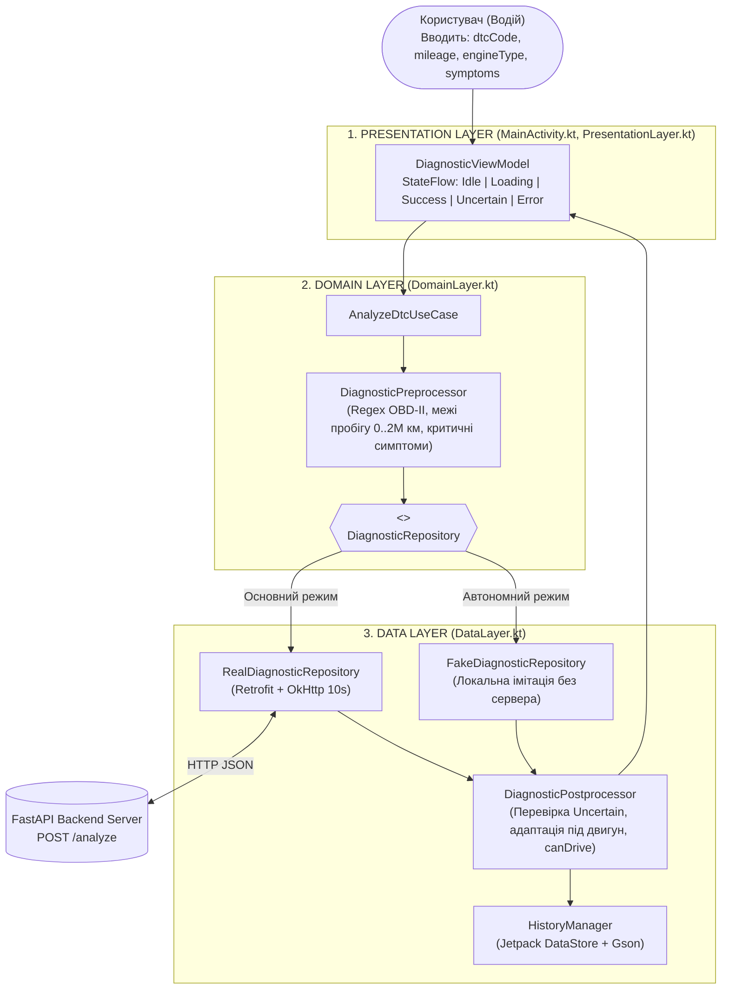

# Архітектура мобільного застосунку (Оновлення ЛР №4)

## Розподіл відповідальності (Separation of Concerns)
Після додавання локального сховища архітектуру мобільного клієнта розділено на три незалежні шари:

1. **Шар представлення (UI Layer — `MainActivity.kt`, `activity_main.xml`):**
   - Збирає вхідні дані користувача та керує станом завантаження (`ProgressBar`).
   - Підписується на реактивний потік `historyFlow` у межах життєвого циклу активності (`lifecycleScope`).
   - Відповідає за відображення списку історії, модального вікна деталей запису (`showRecordDetailsDialog`) та діалогів підтвердження видалення. Не містить прямого коду роботи з файлами чи серіалізацією.

2. **Шар локальних даних (Persistence Layer — `HistoryManager.kt`, `DiagnosticRecord.kt`):**
   - Інкапсулює всю роботу з постійним сховищем `Jetpack DataStore (Preferences)`.
   - Забезпечує потокобезпечні асинхронні операції: додавання запису на початок списку (`saveRecord`), видалення за ідентифікатором (`deleteRecord`), повне очищення (`clearHistory`) та читання через `Flow`.
   - Фізично зберігає дані у внутрішній захищеній директорії додатка (`/data/data/com.example.smartwrench/files/datastore/smartwrench_history.preferences_pb`).

3. **Мережевий шар (Network Layer — `NetworkClient`, `SmartWrenchApi.kt`, `Models.kt`):**
   - Виконує HTTP-запити до AI-бекенду через `Retrofit2` та конвертує мережеві DTO (`DTCRequest`, `DTCResponse`).

# Архітектура мобільного застосунку SmartWrench (Оновлення ЛР №5)

## 1. Обраний підхід
У межах Лабораторної роботи №5 (Варіант А) виконано декомпозицію монолітного класу `MainActivity` на тришарову архітектуру (Presentation, Domain, Data) з використанням патернів MVVM, Use Case, Repository, Mapper та Constructor Dependency Injection.

## 2. Потік керування та даних
1. **UI (`MainActivity`)** передає події користувача (`analyze`, `retryLastRequest`) у `DiagnosticViewModel`.
2. **`DiagnosticViewModel`** переводить екран у стан `DiagnosticUiState.Loading` і викликає `AnalyzeDtcUseCase`.
3. **`AnalyzeDtcUseCase`** нормалізує код помилки та перевіряє його за регулярним виразом `^[PCBU][0-9A-Z]{3,4}$`. У разі помилки валідації негайно повертає `Result.failure(DomainError)` без звернення до мережі.
4. **`DiagnosticRepository` (інтерфейс)** делегує виконання одній із двох реалізацій:
   - `RealDiagnosticRepository`: використовує `DiagnosticMapper` для створення `DTCRequest`, викликає `SmartWrenchApi` (Retrofit) та мапить `DTCResponse` у доменну модель `DiagnosticPrediction`.
   - `FakeDiagnosticRepository`: повертає детермінований результат у пам'яті для модульного тестування та офлайн-демонстрації.
5. У разі успіху результат зберігається у локальне сховище `HistoryManager` (`DataStore`) і публікується у `StateFlow<DiagnosticUiState.Success>`.

# Архітектура системи SmartWrench (Фінальна версія `lab7-final`)

## 1. Схема компонентів та потоку даних

## 2. Місце виконання AI та основні архітектурні рішення
1. **Гібридний розподіл AI-логіки:** Генерація експертних рекомендацій виконується на локальному FastAPI backend-сервері, тоді як валідація ознак (`DiagnosticPreprocessor`) та контроль безпеки висновків і стану `Uncertain` (`DiagnosticPostprocessor`) реалізовані на клієнті.
2. **Ізоляція зовнішніх залежностей (DI):** `DiagnosticViewModel` не залежить від `Retrofit` чи `Context` і отримує `AnalyzeDtcUseCase` через `DiagnosticViewModelFactory`.
3. **Постійне локальне сховище:** Історія успішних діагностик зберігається у файлі `smartwrench_history.preferences_pb` (`Jetpack DataStore`) у зворотному хронологічному порядку.
